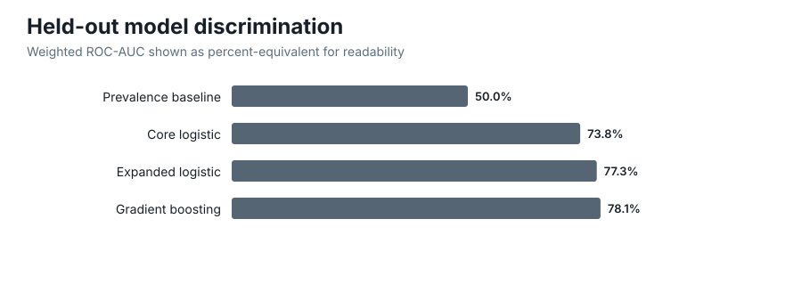
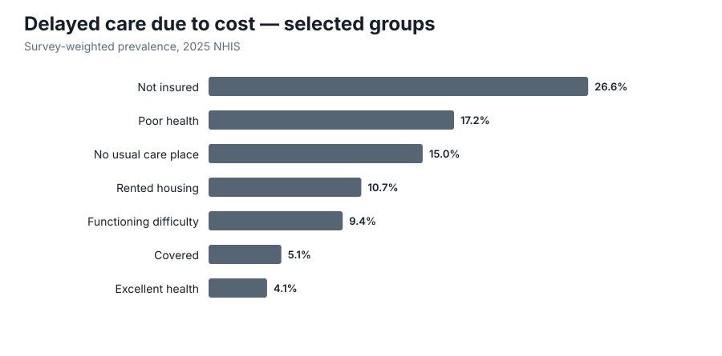
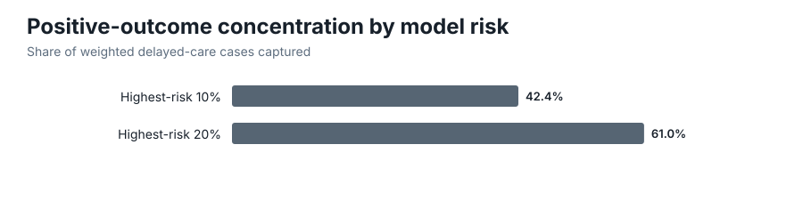
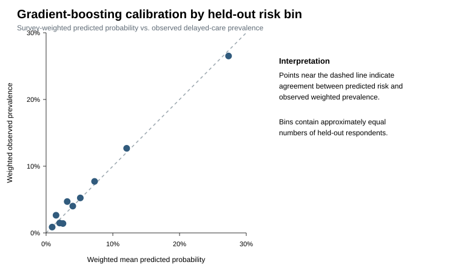
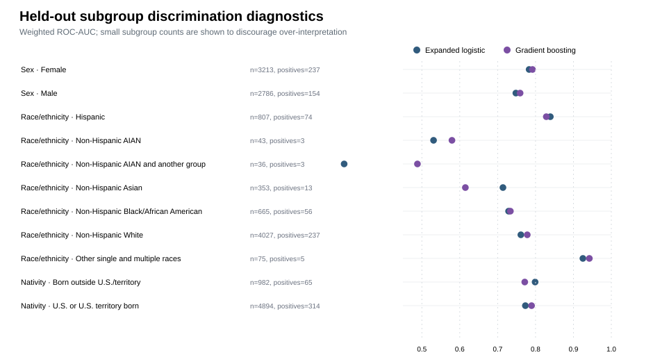

# 2025 NHIS Healthcare Access Analysis

A reproducible Python project combining **complex-survey inference, multiple imputation, and predictive modeling** to examine cost-related delayed medical care among U.S. adults using the **2025 National Health Interview Survey (NHIS)**.

The project deliberately separates two questions:

1. **Population inference:** Which groups experience the highest prevalence of delaying medical care because of cost?
2. **Predictive modeling:** How well can a curated set of demographic, socioeconomic, access, and health characteristics distinguish adults who report cost-related delayed care during the prior 12 months?

NHIS is a complex probability survey, so survey-weighted population estimates and predictive model performance are treated as related but distinct analytical products.

## Why this matters

Delaying medical care because of cost is a direct measure of healthcare-access difficulty. This project uses nationally representative survey methods to show where that burden is concentrated, then separately asks whether observable characteristics can meaningfully distinguish respondents at higher reported risk. The goal is not to automate care decisions, but to combine rigorous population inference with transparent predictive benchmarking.

**Review the analysis:** [Exploratory notebook](notebooks/01_exploratory_analysis.ipynb) · [Survey + modeling notebook](notebooks/02_survey_and_modeling_analysis.ipynb) · [Nonlinear benchmark notebook](notebooks/03_nonlinear_benchmark_and_interpretability.ipynb)











## Project highlights

- 2025 NHIS Sample Adult analysis with **24,215 respondents**
- survey-weighted prevalence estimates using the final annual weight, public stratum, and PSU variables
- Taylor-linearized standard errors and transparent t-based confidence intervals for overall and subgroup estimates
- all **10 official income imputations** retained and pooled rather than reduced to a single imputation
- curated feature design instead of indiscriminately modeling all 577 public-use adult variables
- held-out logistic-regression baselines and one nonlinear gradient-boosting benchmark
- weighted ROC-AUC, average precision, Brier score, log loss, calibration, and risk-concentration diagnostics
- held-out permutation importance plus subgroup discrimination/calibration diagnostics for model interpretability and responsible review
- **3 fully executed review notebooks** with rendered tables and linked SVG figures
- automated source validation, analytical tests, notebook execution, and independent R `survey` cross-checks of representative survey estimates
- committed [R-vs-Python survey cross-check table](validation/survey_crosscheck.csv) with tolerances and pass/fail status
- consolidated machine-readable [project summary](data/processed/project_summary.json) for rapid review of sample, inference, and model results
- reproducible CDC/NCHS data download with checksum verification

## Primary outcome

`MEDDL12M_A` — delayed medical care because of cost during the past 12 months.

The closely related `MEDNG12M_A` variable — needed medical care but did not get it because of cost — is retained as a **secondary outcome** and intentionally excluded from the predictor matrix to prevent target leakage.

## Key findings

These results describe the 2025 NHIS public-use Sample Adult data and should be interpreted as **associational, not causal**.

### Survey-weighted population estimates

- Estimated prevalence of delayed medical care because of cost is **7.05%** (95% CI **6.62%–7.48%**).
- Adults without health insurance have an estimated prevalence of **26.6%**, compared with **5.1%** among covered adults.
- Adults with no usual place of care are at **15.0%**, compared with **6.1%** among adults with one usual place of care.
- Adults reporting poor general health are at **17.2%**, compared with **4.1%** among adults reporting excellent health.
- Adults with a functioning difficulty are at **9.4%**, compared with **4.7%** among adults without one.
- Renters are at **10.7%**, compared with **5.4%** among adults living in an owned or being-bought residence.
- The South has the highest regional estimate at **8.6%**, while the Northeast is lowest at **5.1%**.

### Multiply imputed income analysis

Using all 10 official income imputations, pooled delayed-care prevalence is approximately:

- **10.4%** below 100% of the federal poverty level
- **11.1%** at 100–199% FPL
- **8.6%** at 200–399% FPL
- **3.6%** at 400%+ FPL

Each completed income dataset is analyzed separately. Point estimates and Taylor-linearized within-imputation variances are then combined using Rubin pooling with the Barnard–Rubin degrees-of-freedom adjustment.

### Predictive modeling

NHIS is cross-sectional, so these models are **retrospective classification/risk-ranking models**, not prospective forecasts of future delayed care. They use characteristics measured in the same interview to distinguish adults who report delayed care because of cost during the prior 12 months.

On the fixed held-out test set:

| Model | Weighted ROC-AUC | Weighted average precision | Weighted Brier score |
|---|---:|---:|---:|
| Prevalence baseline | 0.500 | 0.072 | 0.0668 |
| Core logistic regression | **0.738** | **0.231** | **0.0612** |
| Expanded logistic regression | **0.773** | **0.272** | **0.0599** |
| Expanded gradient boosting | **0.781** | **0.267** | **0.0599** |

The expanded specification adds general health and functioning difficulty to the access/demographic core model. Gradient boosting provides a modest improvement in weighted ROC-AUC and probability-loss metrics, but its weighted average precision is slightly below expanded logistic regression. The more complex model therefore does **not** dominate on every metric.

Adding multiply imputed poverty ratio produces a further modest and highly stable improvement in the logistic specifications: mean weighted ROC-AUC rises to approximately **0.751** for the core-plus-income model and **0.781** for the expanded-plus-income model across the 10 imputations. These predictive metrics are summarized across 10 separately fitted completed datasets as an **imputation-sensitivity analysis**; they are not Rubin-pooled inferential quantities.

The nonlinear model is useful as a risk-ranking benchmark: the **highest-risk decile of held-out respondents** contains about **42.4%** of weighted positive outcomes, and the top two respondent deciles contain about **61.0%**. The deciles contain approximately equal numbers of held-out respondents; observed outcome prevalence and positive-outcome concentration within them are computed using the NHIS final survey weight. Held-out permutation importance ranks insurance status and age highest, followed by functioning difficulty and general health. These are predictive importance measures, not causal effects.

Because the positive outcome is uncommon, a default probability cutoff of 0.50 yields low recall. The project therefore emphasizes discrimination, precision-recall performance, calibration-oriented loss metrics, and risk ranking rather than raw accuracy or an arbitrary operating threshold.

### Subgroup model diagnostics

The repository also reports held-out discrimination and calibration diagnostics for **sex, race/ethnicity, and nativity** for the expanded logistic and gradient-boosting models. These diagnostics include subgroup sample sizes and positive counts so that very small groups are visible rather than silently summarized. They are intended as a responsible-model review aid, not as a claim that a model is fair or unfair for any group. See [`data/processed/model_subgroup_metrics.csv`](data/processed/model_subgroup_metrics.csv).

### Example analytical decision

The population-inference and predictive-modeling results answer different questions and should lead to different uses. For example, adults without health insurance have an estimated delayed-care prevalence of about **26.6%**, compared with about **5.1%** among covered adults. That is a large population-level disparity worth describing and investigating.

The predictive models, however, should not be turned into an individual eligibility or intervention rule. The strongest benchmark reaches a weighted ROC-AUC of about **0.781**, and the highest-risk respondent decile contains about **42.4%** of weighted positive outcomes. Those results show useful risk concentration, but they also leave substantial overlap between respondents with and without reported delayed care.

A defensible analytical use is therefore to treat the survey estimates as evidence about where access burdens are concentrated and the models as transparent benchmarking/risk-ranking tools—not as causal explanations or automated healthcare-access decisions.

## Analytical design

**Core model:** age, sex, race/ethnicity, education, marital status, family composition, housing tenure, employment, nativity, insurance status, usual place of care, region, and urban-rural classification.

**Expanded model:** the core model plus general health status and functioning difficulty.

**Nonlinear benchmark:** histogram gradient boosting using the expanded feature set and the identical held-out test set. All model comparisons are retrospective classification benchmarks on the cross-sectional 2025 NHIS sample.

**Model-development strategy:** the project intentionally uses stable, prespecified benchmark models rather than an extensive hyperparameter search. Preprocessing is fit only on training data, and all principal model comparisons use the same fixed held-out test set. This prioritizes transparent comparison and reduces the risk of tuning to a single test split.

**Income extensions:** the core and expanded logistic models plus top-coded family poverty ratio, refit independently for each of the 10 official income imputations.

Citizenship status is retained for descriptive analysis but intentionally excluded from the default predictive models.

## Notebooks

### 1. [Exploratory analysis](notebooks/01_exploratory_analysis.ipynb)

Compact review of outcome prevalence and survey-weighted subgroup estimates generated by the reproducible analysis pipeline.

### 2. [Survey analysis and predictive modeling](notebooks/02_survey_and_modeling_analysis.ipynb)

Reviews survey-weighted prevalence with Taylor-linearized confidence intervals, pooled income estimates across all 10 imputations, and held-out predictive-model performance generated by the pipeline.

### 3. [Nonlinear benchmark and interpretability](notebooks/03_nonlinear_benchmark_and_interpretability.ipynb)

Reviews the nonlinear benchmark through permutation importance, weighted calibration, respondent-based risk deciles, and cumulative concentration of weighted positive outcomes.

## Repository structure

```text
.
├── .github/workflows/quality-checks.yml
├── assets/
├── data/
│   ├── raw/
│   │   └── README.md
│   ├── processed/
│   │   ├── survey_group_estimates.csv
│   │   ├── income_pooled_estimates.csv
│   │   ├── model_metrics.csv
│   │   ├── model_subgroup_metrics.csv
│   │   ├── boosting_permutation_importance.csv
│   │   ├── boosting_calibration.csv
│   │   ├── boosting_risk_deciles.csv
│   │   ├── project_summary.json
│   │   └── ...
│   └── README.md
├── notebooks/
│   ├── 01_exploratory_analysis.ipynb
│   ├── 02_survey_and_modeling_analysis.ipynb
│   └── 03_nonlinear_benchmark_and_interpretability.ipynb
├── scripts/
│   ├── download_data.py
│   ├── prepare_data.py
│   ├── survey_analysis.py
│   ├── train_models.py
│   ├── check_reproducibility.py
│   └── run_pipeline.py
├── tests/
├── validation/
│   ├── README.md
│   └── reference_survey_check.R
├── DATA_USE.md
├── LICENSE
├── requirements.txt
└── README.md
```

Respondent-level processed intermediates are reproducible but intentionally excluded from Git history. The repository retains only aggregate/model-summary analytical outputs needed to review the results.

## Reproduce the project

The repository supports **Python 3.14+** and was developed and locally validated on Python 3.15. GitHub Actions uses Python 3.14 for reliable binary-wheel availability with the pinned scientific stack.

```bash
python3 -m venv .venv
source .venv/bin/activate
python -m pip install --upgrade pip
python -m pip install -r requirements.txt
```

Download the two official 2025 NHIS public-use files and verify them against the NCHS-published MD5 checksums:

```bash
python scripts/download_data.py
```

Run the complete analytical pipeline:

```bash
python scripts/run_pipeline.py
```

Run the validation suite:

```bash
python -m pytest -q -p no:cacheprovider
```

Open the notebooks locally with:

```bash
jupyter lab
```

GitHub Actions repeats source download/checksum verification, the analytical rebuild, generation of review figures and the consolidated project summary, a tolerance-aware reproducibility check for tracked analytical outputs, the full Python validation suite, execution of all three review notebooks, and an independent cross-check of representative survey estimates with R's `survey` package on every push or pull request. The R validation also regenerates an inspectable comparison table and verifies every recorded difference is within tolerance.

## Methodological guardrails

### Complex survey inference

Population estimates use:

- `WTFA_A` — final annual Sample Adult weight
- `PSTRAT` — annual public variance stratum
- `PPSU` — annual public variance PSU

Subgroup estimates are treated as survey domains rather than independent simple random samples. The project computes Taylor-linearized standard errors and two-sided t-based intervals using the public-design degrees of freedom. Representative point estimates and standard errors are independently cross-checked against R's `survey` package in CI. NCHS's 2025 PRICSSA guidance recommends Korn-Graubard/Clopper-Pearson confidence intervals for publication-grade presentation of proportions; this repository documents that distinction rather than claiming its interval construction is identical to the NCHS presentation standard. See [`validation/README.md`](validation/README.md).

### Multiple imputation

The ordinary Sample Adult file contains poverty measures based on the **first** imputation. This project instead uses the separate Sample Adult Income file and retains all **10** imputations.

Income-dependent survey estimates are computed in each completed dataset and pooled using within- and between-imputation variance with the Barnard–Rubin degrees-of-freedom adjustment. For predictive modeling, income-enhanced models are refit separately across all 10 imputations and performance variation is reported as a sensitivity analysis rather than treated as Rubin-pooled model-performance inference. The 10 imputed records are never treated as 10 independent respondents.

### Predictive modeling is neither prospective nor causal inference

NHIS is a cross-sectional household interview survey. The predictive models are therefore evaluated as retrospective classification and score-ranking tools, not as forecasts of future delayed care. Survey weights are used as model/evaluation sample weights, but logistic coefficients, subgroup performance, and boosting feature importance are **not** presented as survey-adjusted causal effects or formal population inference. Calibration bins and risk deciles are formed by respondent rank, with survey weights used for the within-bin outcome summaries. Associations may reflect confounding, temporal ambiguity, measurement differences, and survey-response processes.

## Data source and attribution

**Data Source:** National Center for Health Statistics, National Health Interview Survey, 2025.

Official 2025 documentation and public-use downloads are available from the [CDC/NCHS 2025 NHIS release](https://www.cdc.gov/nchs/nhis/documentation/2025-nhis.html).

The analysis, interpretations, and conclusions in this repository are those of the author and are not attributable to the National Center for Health Statistics, which is responsible only for the initial data.

The raw CDC/NCHS files are intentionally excluded from Git history. See [`DATA_USE.md`](DATA_USE.md) and [`data/raw/README.md`](data/raw/README.md) for source, checksum, and data-use details.

## License

Original code and repository documentation are available under the [MIT License](LICENSE). The MIT License does **not** relicense the National Health Interview Survey source data; use of NHIS data remains subject to the NCHS data-use terms described in [`DATA_USE.md`](DATA_USE.md).
